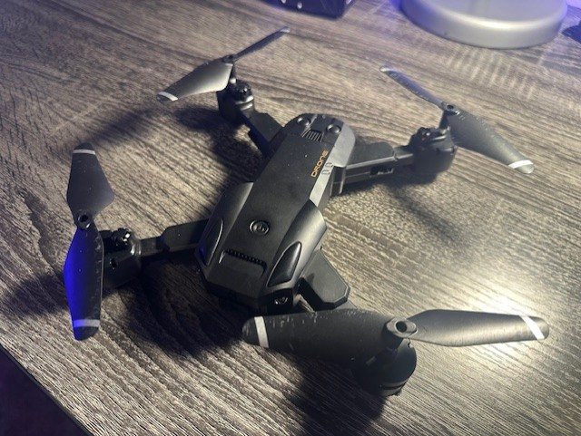

# Pwn a Drone

## Description

Python code to control and view the camera feed on a cheap generic drone I found.

I can't offer much to identify this drone other than a picture:



And the app used to control it called 'RC FPV'

[Google Play](https://play.google.com/store/apps/details?id=com.cooingdv.rcfpv&hl=en-US)
[Apple App Store](https://apps.apple.com/us/app/rc-fpv/id1532634846)

## Setup

Install the required Python dependencies:
```
pip install -r requirements.txt
```

## Usage

Connect to the drone's Wi-Fi network (should be something like WIFI_8K_XXXXXX) and then run:

For a live feed from the drone's camera:
```
python3 camera.py
```

For live control via a connected gamepad (I used a PS5 Dualsense controller):
```
python control.py
```


## Video Demo

Click [here](https://www.youtube.com/shorts/qLBCsTfVRjs) to watch the video on YouTube.
